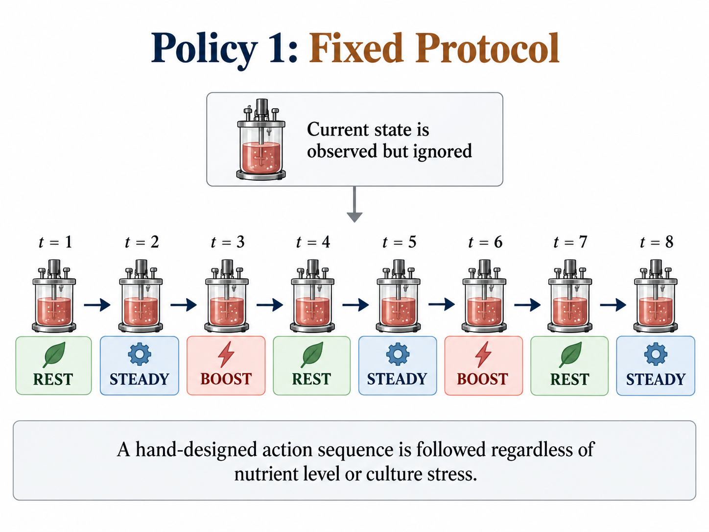
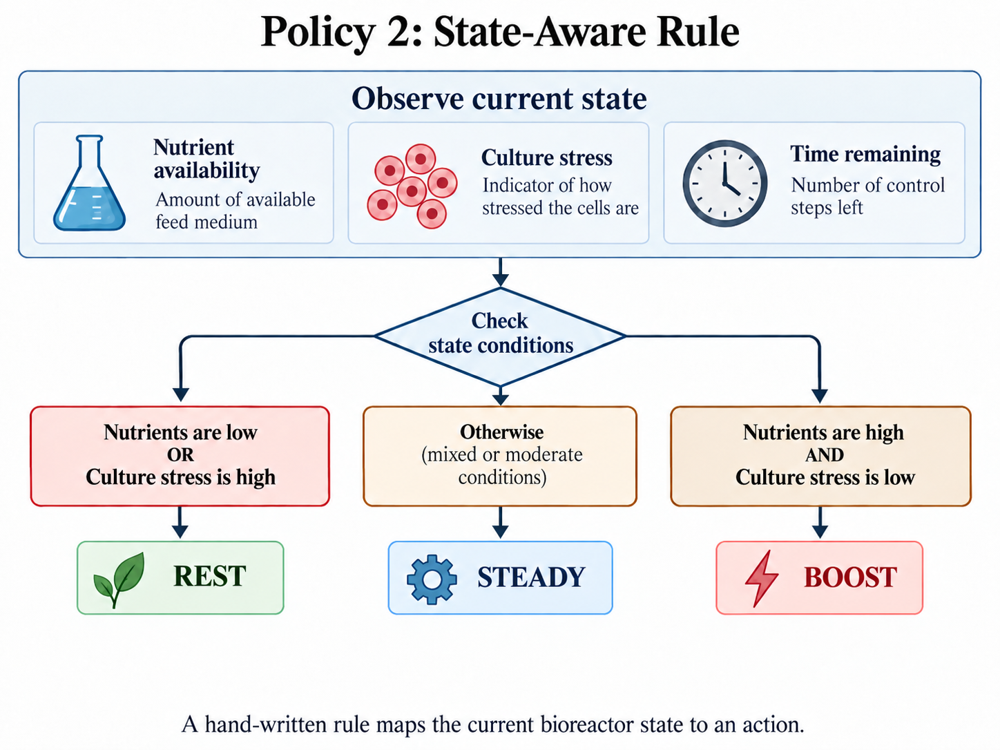
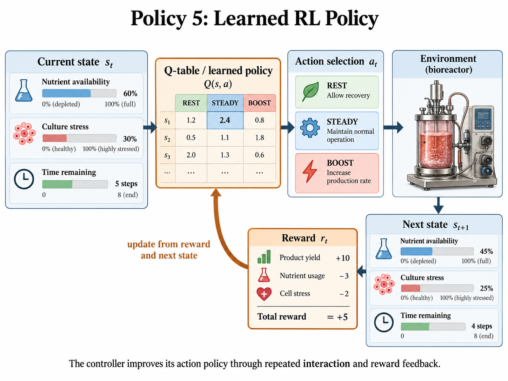
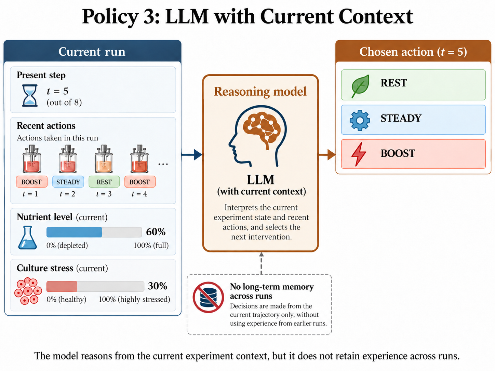
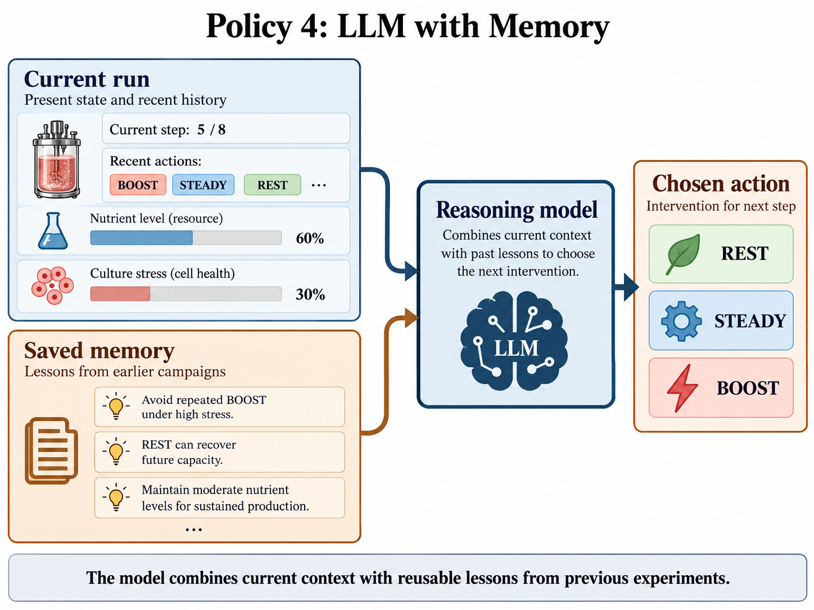

# Policy descriptions

This document describes the policies evaluated in `Self_Improving_Agents_Memory_vs_RL.ipynb`. The process is synthetic and has eight decision stages. At each stage, the observed state is `(step, nutrient, stress)`. Available actions are `REST`, `STEADY`, and `BOOST`.

## Environment and objective

Each run begins with nutrient sampled from 2 through 4 and stress sampled from 0 through 1. After each action, there is a 10% chance that nutrient decreases by one additional unit. The run ends after eight actions.

The per-step transitions are:

| Action | Nutrient transition | Stress transition | Production | Cost |
|---|---|---|---:|---:|
| `REST` | increase by 2, capped at 4 | decrease by 2, floored at 0 | 0 | 0.5 |
| `STEADY` | decrease by 1, floored at 0 | decrease by 1, floored at 0 | 2 with probability `max(0, 0.88 − 0.06 × stress)` when nutrient is at least 1; otherwise 0 | 0.7 |
| `BOOST` | decrease by 2, floored at 0 | increase by 2, capped at 3 | 6 with probability `max(0.03, 0.94 − 0.24 × stress)` when nutrient is at least 2; otherwise 0 | 2.0 |

Before the final stage, reward is `4 × production − cost`. At the final stage, the reward also includes `−5 × final stress`.

## Evaluated policies

### Random

At each stage, select one of the three actions uniformly at random.

### Always STEADY

Select `STEADY` at every stage.

### Fixed alternating

Select `BOOST` at steps 1, 3, 5, and 7. Select `REST` at steps 2, 4, 6, and 8. In the implementation, the zero-indexed step value is even for `BOOST` and odd for `REST`.



### State-aware rule

The policy uses the following fixed rule:

```python
if nutrient >= 2 and stress <= 1:
    action = "BOOST"
elif nutrient >= 1:
    action = "STEADY"
else:
    action = "REST"
```

This rule uses the current nutrient and stress values. It does not use the number of stages remaining, earlier rewards, or training data.



### Participant-defined rule

The notebook includes a separate `participant_rule` exercise. Participants edit that function only; it receives `(step, nutrient, stress)` and returns `REST`, `STEADY`, or `BOOST`. The notebook evaluates the submitted rule on the same 1,000 held-out seeds as the reference policies and displays one trace for seed 2026. The reference state-aware rule is not modified.

### RL policy

The RL policy is a table with one estimated value for each state-action pair:

```text
Q[step, nutrient, stress, action]
```

Training uses 12,000 simulated runs by default. During training, the controller sometimes tries a random action. The probability of doing so is:

```text
epsilon = 0.035 + 0.40 × exp(−episode / 7500)
```

After each action, the table is updated with the observed reward and the estimated value of the next state:

```text
Q(s, a) ← Q(s, a) + alpha × [reward + max_a' Q(s', a') − Q(s, a)]
```

At the last stage, the estimate of the next state is zero. The update size becomes smaller as the controller visits a state-action pair more often, but does not drop below 0.04. During testing, the policy chooses the action with the largest table value for the observed state. No language-model weights are trained or changed.



### LLM with current context

At each stage, the language model receives the current state, the number of stages remaining, and all observations from the current run. It returns one action and a short explanation in JSON format.



### LLM with current context and memory

This condition receives the same current-run information as the context-only condition. It also receives a text summary generated from six earlier simulated runs. The six runs use the following fixed protocol and seed pairs:

| Protocol | Seed |
|---|---:|
| Always STEADY | 301 |
| Fixed alternating | 302 |
| State-aware rule | 303 |
| Fixed alternating | 304 |
| State-aware rule | 305 |
| Always STEADY | 306 |

The language model is called separately at every stage in both conditions.



The diagrams summarize the policies. The rules, prompts, and code define the policies used in the evaluation.

## Prompts

All language-model calls include the following system instruction:

```text
You are assisting a fictional scientific research tutorial. Use only evidence supplied by the user, distinguish predictions from measurements, and do not invent replicated results.
```

### Memory-generation prompt

`{experience_rows}` is a JSON-formatted record of the six traces described above.

```text
You are creating reusable memory for an LLM scientific decision agent.
The setting is a FICTIONAL eight-stage process. Each stage, choose REST, STEADY or BOOST.
REST restores resources and reduces stress. STEADY produces modest output and reduces stress;
BOOST can produce more but depletes resources and increases stress. The final objective
includes total production, costs, and a terminal stress penalty. Every step changes the next state.

Here are SIX prior simulation traces:
{experience_rows}

Return 4 to 6 short, actionable lessons grounded in the traces, including when REST may help,
when BOOST may backfire and why time remaining matters. Clearly say that six episodes are insufficient
to establish an optimal policy. Do not invent numerical results.
```

### Stage-level action prompt

`{state}`, `{trace}`, and `{memory}` are replaced with the current simulator values. For the context-only condition, `{memory}` is `(none)`.

```text
You are controlling a SYNTHETIC scientific process for 8 decisions.
REST: gain 0; restore nutrient by 2; reduce stress by 2; cost 0.5. STEADY: if nutrient >= 1, usually gain 2; consume nutrient 1; reduce stress by 1; cost 0.7. BOOST: if nutrient >= 2, possibly gain 6; consume nutrient 2; increase stress by 2; cost 2.0. BOOST can fail at high stress. Occasional disturbances remove nutrient. Final objective = 4 * total production - costs - 5 * final stress. This is a synthetic, not a physical, experimental process.
Current state (step, nutrient, stress): {state}
Steps remaining: {8-state[0]}
Previous observations in THIS run: {trace}
Saved lessons from earlier runs: {memory}
Choose the next action to maximize the FINAL total reward rather than immediate gain.
Respond with JSON: {"action":"REST|STEADY|BOOST","reason":"short explanation"}.
Do not invent experiment observations.

Return ONLY a JSON object. No markdown.
```

The client adds the final instruction, `Return ONLY a JSON object. No markdown.`, when it requests a JSON response.

## Evaluation protocol

The non-language-model policies are tested on seeds 10,000 through 10,999, for 1,000 runs per policy. The reference RL policy is trained with seed 7. The language-model conditions use `LIVE_SEED = 2301`; one paired comparison does not estimate typical performance.
