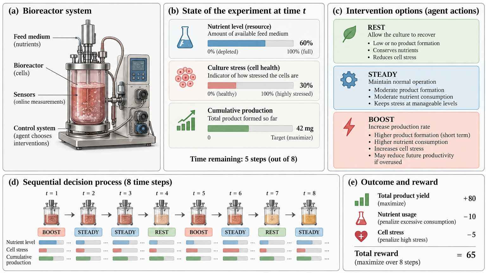

# U of T Fall School | Self-Improving Scientific Agents Lab

## The question

When does a learned decision rule improve results compared with a fixed rule or a language model that chooses actions from the available information?

This repository contains a synthetic eight-step resource-and-stress control experiment. It is not a validated physical or biological model. See [Policy descriptions](POLICY_DESCRIPTION.md) for the policies, decision rules, and language-model prompts used in the lab.



The first five methods are tested on 1,000 simulated runs not used for training. The language-model demonstration uses one paired seed, so it cannot establish a general performance difference. The RL controller receives more simulated training runs than the language-model memory condition.

## 1. Install software

Install Python 3.11 or 3.12, unzip the participant package, and open a terminal in the extracted folder.

**Windows PowerShell**

```powershell
py -3.11 -m venv .venv
.venv\Scripts\python.exe -m pip install -r requirements.txt
.venv\Scripts\python.exe -m jupyter lab
```

If your Python installation is 3.12, use `py -3.12` instead.

**macOS / Linux**

```bash
python3 -m venv .venv
.venv/bin/python -m pip install -r requirements.txt
.venv/bin/python -m jupyter lab
```

Use the link displayed in the terminal to open JupyterLab in a web browser.

## 2. Configure the LLM API

Copy `api_config.py` to `api_config_local.py`, then paste your OpenRouter key into `API_KEY` in `api_config_local.py`. The provider, model ID, and endpoint are already set for OpenRouter. The local file is ignored by Git, and both the notebook and the Python script read it. A key in `api_config.py` also works locally, but that file is tracked by Git and must never be committed with a real key.

The current settings are `PROVIDER = "openai_compatible"`, `MODEL = "openai/gpt-5.6-luna"`, and `BASE_URL = "https://openrouter.ai/api/v1"`. Change these only if you use a different provider or model.

Do not paste an API key in the notebook or include a real key in a commit.

## 3. Open the notebook

In JupyterLab, open `Self_Improving_Agents_Memory_vs_RL.ipynb`. Select the Python kernel from `.venv` (Jupyter may prompt you to install/register it). Start with **Run All**. The first code cell checks the school API with a real call; it will stop if the key or endpoint is invalid.

### Run it in VS Code

1. Install the Microsoft **Python** and **Jupyter** extensions in VS Code.
2. Use **File → Open Folder** and open the repository folder (the folder containing `simulator.py`, `llm_client.py`, and `api_config.py`). Do not open the notebook as an isolated file.
3. Open the integrated terminal. If `.venv` has not been created on this computer, run:

   ```bash
   python3 -m venv .venv
   .venv/bin/python -m pip install -r requirements.txt
   ```

4. Open `Self_Improving_Agents_Memory_vs_RL.ipynb`. Choose **Select Kernel** in the upper right, then choose the Python environment at `.venv/bin/python`.
5. Choose **Clear All Outputs** in the notebook toolbar, then run the first code cell. It sends a real API request. If it succeeds, use **Run All** or run cells individually.

The notebook stores previous outputs. This copy may show an old `.env` configuration error until its outputs are cleared. In VS Code, select the local `.venv` kernel; a Jupyter Server password is not needed for that local kernel.

The parameter exercise is intended to be run before the language-model sections. Running all notebook cells also makes model calls in the final sections. One paired demonstration uses approximately 18 calls plus possible retries. The default safety cap is 35 calls; change `MAX_MODEL_CALLS` in `api_config_local.py` for a local class run if needed.

## 4. The experiment you will run

Each run has eight decisions. At every step, the system has a **nutrient level** and **stress level**. `REST` recovers nutrient and lowers stress. `STEADY` can produce a smaller amount. `BOOST` can produce more but uses more nutrient and increases stress. A random event may remove nutrient. Each action affects the next state and the final result.

Reward: **4 × total simulated production − total intervention costs − 5 × final stress**.

### Reference benchmark

Run the benchmark section. Its expected result (training seed 7; 1,000 test runs) is approximately:

| Controller | Mean simulated reward |
|---|---:|
| RL, 12,000 training campaigns | **75.57** |
| State-aware handwritten rule | 67.48 |
| Fixed BOOST / REST alternation | 64.83 |
| Random | 28.97 |
| Always STEADY | 14.25 |

The paired difference between RL and the state-aware rule is 8.09 reward points, with an approximate 95% interval of [7.11, 9.07]. This result does not establish performance relative to an optimal hand-coded policy or an LLM in other settings.

### Change one number

Section 4 contains:

```python
TRY_TRAIN_EPISODES = 100  # Try 500, 3_000, 12_000
```

Start with 100 and rerun that cell. Compare the learned controller with the *original 12,000-run controller* and the state-aware rule. Then try 3,000 or 12,000. No language-model API calls are needed.

The following cell repeats training with **five seeds** to show whether the result is consistent across training runs.

### Memory and reasoning vs RL

The memory and language-model sections require the live API. They:

1. Collect six example trajectories from predefined protocols.
2. Ask the LLM to turn them into reusable lessons.
3. Run the same language model once using current information only and once with saved memory.
4. Compare the outcomes with RL and a fixed rule using the same starting seed.

The language-model comparison consists of one run per condition and is not an estimate of typical language-model performance.

See [Policy descriptions](POLICY_DESCRIPTION.md) for the rules, prompts, and evaluation settings.

## Reproducible benchmark results

Run `python run_benchmark.py` to reproduce the simulator-only analysis. It does not make API calls. With training seed 7, 12,000 training campaigns, and evaluation seeds 10,000–10,999, the results are:

| Controller | Mean return | SD across runs |
|---|---:|---:|
| RL learned policy | 75.57 | 12.30 |
| State-aware rule | 67.48 | 17.03 |
| Fixed BOOST/REST alternation | 64.83 | 23.32 |
| Random | 28.97 | 18.07 |
| Always STEADY | 14.25 | 7.35 |

The paired RL-minus-state-aware difference is 8.09 points, with an approximate 95% interval of [7.11, 9.07]. A shared seed fixes initial conditions but not the full stochastic path when policies take different actions.

The benchmark also trains policies using five independent training seeds and evaluates each on 500 held-out campaigns.

| Training campaigns | Mean RL return | SD across training seeds |
|---:|---:|---:|
| 100 | 62.66 | 3.46 |
| 500 | 68.56 | 1.68 |
| 3,000 | 73.90 | 1.29 |
| 12,000 | 75.95 | 0.49 |

The simulator gives a reward after each action and includes the information needed to calculate the final stress penalty. The results apply only to this simulator and its stated test procedure.

## Files included

- `Self_Improving_Agents_Memory_vs_RL.ipynb`: tutorial notebook.
- `Self_Improving_Agents_Memory_vs_RL.py`: standalone Python version of the tutorial.
- `simulator.py`: synthetic process and RL learner.
- `llm_client.py`: API interface with a call limit.
- `api_config.py`: shareable API configuration template.
- `api_config_local.py`: ignored local configuration containing the API key; create it by copying `api_config.py`.
- `.gitignore`, `requirements.txt`: repository and package setup.
- `run_benchmark.py`: reproducibly regenerate all benchmark numbers with **no API calls**.
- `solutions/`: benchmark figures, CSVs, and JSON results for participant reference.

## Troubleshooting

**Authentication errors:** verify the provider, model, API key, and base URL in `api_config_local.py` or `api_config.py`. Ask the organizer about rate limits.

**ModuleNotFoundError:** use the Jupyter Python kernel created by your `.venv`, and install all packages with that environment's Python.

**429 or timeouts:** wait or ask for help. Restarting `Run All` repeatedly will send extra paid calls.

**Model produces malformed JSON:** the helper may use a second live call to repair it; after the call cap it raises an error rather than silently substitute data.

**No RL benefit:** check that `TRAIN_EPISODES` is 12,000, the test uses the same reward settings as training, and the script was not changed. After changing the simulator, train the policy again before testing it.

## Scientific limitations

This synthetic experiment is designed so that actions affect later decisions. The results do not show that RL is generally better than other fixed rules or language models. The memory condition receives six earlier runs, whereas RL receives thousands. A real scientific use would require independent validation, safety constraints, and comparison of data, computation, and API costs.
